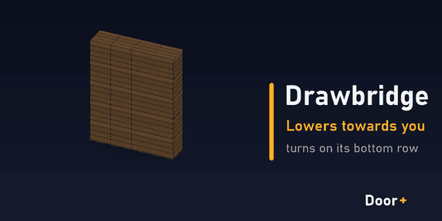

# Drawbridge

The drawbridge tips 90° around a horizontal row of blocks, the hinge row. A standing wall falls flat (a castle bridge),
a flat floor rises into a wall or drops into a pit (a hatch). This page explains how to build one, which blocks to
click and how the direction works. Creation id: `drawbridge`.

## What it does

| State | Position |
|---|---|
| Closed (0) | The blocks where you built them |
| Open (1) | The blocks turned 90° around the hinge row |

The **direction** is the side the **top face** of the door turns towards. In practice:

| You built... | Hinge row | The door opens... |
|---|---|---|
| A standing wall | Bottom row | Falls flat towards the direction, at the height of the hinge row |
| A standing wall | Top row | Swings up and ends flat on the side **opposite** to the direction |
| A flat floor | One edge | Direction = the side of the hinge edge: rises into a wall standing on the hinge row. Direction = the other side: drops down into a wall hanging below the hinge row |

Stairs, slabs, logs and other blocks with a direction are turned with the door where Minecraft allows it.

## How to build it

- **Shape**: any box. Usually a wall or a floor 1 block thick.
- **Front**: the drawbridge has no front; the direction decides the side.
- **Hinge row**: a full row of the door, running east–west or north–south. The door turns around the centres of the
  blocks of this row, and the row itself stays in place.
- **Free space**: the open position and the quarter circle the door sweeps must be free. See
  [Free space](../movement.md#free-space).

**Worked example**: a castle bridge 5 blocks wide (east–west) and 7 blocks tall, 1 block thick, standing in the gate
of a wall, with a moat to the south.

- Hinge: the bottom row. Direction: **South**.
- Open, the bridge lies flat at the height of the hinge row: 5 blocks wide and 7 blocks deep towards the south (the
  hinge row is the first of the 7).
- While it falls, the top edge draws a quarter circle with a radius of 6 blocks south of the wall, which must be
  empty.

## Creating it

1. Type `/dp create drawbridge [name]`. You receive the creation stick.
2. If you did not give a name, type it in chat.
3. Click the first corner of the door with the stick.
4. Click the opposite corner.
5. **Pivot**: click a block of the hinge row. Which blocks you may click depends on the shape:

    | Shape of the region | What to click | Hinge row |
    |---|---|---|
    | 1 block thick north–south and wider east–west (a wall or a strip running east–west) | Any block | The east–west row at the height you click |
    | 1 block thick east–west and wider north–south | Any block | The north–south row at the height you click |
    | Anything else (a floor, a thick box) | A block on the outer edge of the footprint | Runs along that edge |

    Chat confirms **Pivot set at x, y, z.** If you click inside a floor, you get **The pivot must be on an edge of the
    door.**

6. **Axis** (only if you clicked a corner of the footprint, which lies on two edges): chat says **The pivot axis is
   ambiguous: click a second block on the pivot row.** Click a second block of the door at the same height, along the
   edge you want as hinge. Chat confirms **Pivot axis set.**
7. **Direction**: click **North** or **South** (hinge row east–west), or **East** or **West** (hinge row north–south).
8. Add triggers if you want, then click **[Create]** on the summary.

The general procedure is on [Creating a door](../creating.md).

## Opening direction

| Hinge row runs | Valid directions | Default order |
|---|---|---|
| East–west | North, South | North, then South |
| North–south | East, West | East, then West |

**Default**: the first direction in this order whose open position is free; if neither is free, the first one. You
can change it later with `/dp set <door> direction <direction>` or the **Direction** button of the door menu, but only
while the door is closed and not moving.

## Type options

The drawbridge has no type settings. General settings are on [Editing and deleting](../editing.md). **Blocks to move**
does not apply to this type.

## On the move

- **Speed**: like the big door, a quarter turn takes the longer of `90 / (speed.degrees-per-second × multiplier)` and
  `(1.571 × radius) / (speed.max-tip-speed × multiplier)` seconds; the radius is the distance from the hinge row to
  the farthest corner of the door. The 7-tall bridge above (radius 6) takes 2 seconds with the default settings.
- **Checks**: the open position and the swept quarter circle must be free (the swept check follows
  `movement.check-swept-volume`).
- **Entities**: see [Collisions](../movement.md#collisions). With the default mode `none`, players standing on a
  rising bridge are not lifted; at the end they are moved out of the blocks if `collision.evict-on-finish` is `true`.

## Sounds

Config section `sounds.drawbridge`:

| Sound | Default |
|---|---|
| `start` | `minecraft:block.chain.break`, volume 1.0, pitch 0.6 |
| `loop` | `minecraft:block.chain.place`, volume 0.6, pitch 0.7, every 8 ticks |
| `end` | `minecraft:block.wood.place`, volume 1.0, pitch 0.5 |

See [Sounds](../movement.md#sounds) for the format.

## Tips and common mistakes

!!! warning "Clicking a middle row of a wall"
    On a wall, the hinge row is the row at the height you click. If you click a block in the middle, the door turns
    around the middle: the top half goes one way and the bottom half the other, and the bottom half usually hits the
    ground. Click a block of the bottom row for a bridge that falls flat.

!!! tip "Trapdoor in a floor"
    For a floor hatch that drops down, pick the direction pointing away from the hinge edge, and leave the space below
    the hinge free.
