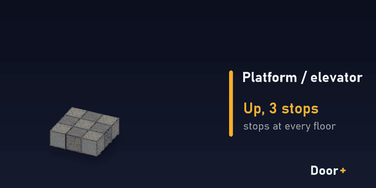

# Platform / elevator

The platform moves in a straight line between up to 8 stops and carries the players standing on it: an elevator, a
moving floor or a lift bridge. This page explains how to build it, how to set the stops and how to send it to a stop.
Creation id: `platform`.

## What it does

The platform has a list of **stops**: distances in blocks from where you built it, along its direction. Stop 0 is
always the built position (distance 0).

| State | Position |
|---|---|
| Stop 0 | The blocks where you built them |
| Stop 1, 2, ... | The blocks moved by the distance of that stop along the direction |

The blocks only move; they are not turned. The door info shows the state as **Stop 0**, **Stop 1**, and so on.

What each action does:

| Action | Result |
|---|---|
| Open | Next stop (stays at the last stop) |
| Close | Previous stop (stays at stop 0) |
| Toggle | Next stop; from the last stop it goes straight back to stop 0 |
| Follow state | Last stop while the source is active, stop 0 when it is inactive |
| Go to stop | The stop you choose, in one movement |

In the door menu, **Open / Close** shows **Position: Stop n**: left click goes to the next stop, right click to the
previous one. By command: `/dp goto <door> <stop>` (the first stop is 0). For buttons that call a specific floor, use
triggers with the **Go to stop** action; see [Triggers](../../access/triggers.md).

## How to build it

- **Shape**: any box. Usually a floor 1 block thick.
- **Front**: none.
- **Free space**: at every stop, the cells where the platform arrives must be free. The cells between two stops are
  **not** checked.

**Worked example**: an elevator with a 3 × 3 floor, 1 block thick, at ground level, serving two upper floors 6 and 12
blocks higher.

1. Build the 3 × 3 floor at the bottom of the shaft and create it with direction **Up**.
2. Its default stops are `0,1` (a flat floor is 1 block tall), so set real stops:
   `/dp set Elevator stops 0,6,12`.
3. `/dp goto Elevator 2` sends it to the top floor; `/dp goto Elevator 0` brings it back down in one movement.

## Creating it

1. Type `/dp create platform [name]`. You receive the creation stick.
2. If you did not give a name, type it in chat.
3. Click the first corner of the door with the stick.
4. Click the opposite corner.
5. **Direction**: click **Up**, **Down**, **North**, **East**, **South** or **West**.
6. Add triggers if you want, then click **[Create]** on the summary.

The stops are not asked during creation: set them afterwards (see [Type options](#type-options)). The general
procedure is on [Creating a door](../creating.md).

## Opening direction

All six directions are valid. **Default order**: Up, Down, North, East, South, West. The default is the first one
whose first stop position is free (with the default stops: one platform-size away); if none is free, Up. Change it
later with `/dp set <door> direction <direction>` or the **Direction** button of the door menu, while the platform is
at stop 0 and not moving.

## Type options

| | |
|---|---|
| Option | `stops` |
| Command | `/dp set <door> stops <list>`, for example `/dp set Elevator stops 0,5,10` |
| Menu | **Type settings** → **Stops**: click, then type the list in chat |
| Format | Whole numbers separated by commas. The first must be `0`, each must be larger than the one before |
| Number of stops | 2 to `limits.max-platform-stops` (default 8) |
| Largest distance | `limits.max-blocks-to-move` (default 64) |
| Default | `0,<size of the platform along the direction>` |
| When | Only while the platform is at stop 0 and not moving |

A wrong list is refused with **Invalid value.** (by command) and the menu asks again. **Blocks to move** does not apply
to this type: the stops replace it.

Config key `types.platform.carry-entities` (default `true`) turns carrying on or off for every platform on the server.

## On the move

- **Speed**: `distance / (speed.blocks-per-second × speed multiplier)` seconds, where the distance is between the two
  stops. 6 blocks at the default 2 blocks per second take 3 seconds.
- **Carrying**: with `types.platform.carry-entities: true`, whatever stands on the top layer of the platform moves with
  it: players (except spectators), other mobs and dropped items. Door+ also places invisible solid colliders under
  the top layer (within `collision.shulker.max-per-door`, default 200), so players do not fall through. This works
  whatever the door's collision mode is.
- **Collisions with other entities**: follow the collision mode; see [Collisions](../movement.md#collisions).
- **Auto-close**: has no effect on platforms.

## Sounds

Config section `sounds.platform`:

| Sound | Default |
|---|---|
| `start` | `minecraft:block.piston.extend`, volume 0.8, pitch 0.5 |
| `loop` | `minecraft:block.beacon.ambient`, volume 0.6, pitch 1.5, every 20 ticks |
| `end` | `minecraft:block.note_block.bell`, volume 0.8, pitch 1.0 |

See [Sounds](../movement.md#sounds) for the format.

## Tips and common mistakes

!!! warning "The platform only moves 1 block"
    A flat platform going up or down has the default stops `0,1`. Set the stops with `/dp set <door> stops ...`.

!!! warning "Cannot change the stops"
    **Close the door first: this can only change while the door is closed and still.** The platform must be at stop
    0. Send it there with `/dp goto <door> 0` first.

!!! tip "Shaft"
    The whole shaft between the current stop and the target stop must be free (or passable, such as barrier):
    otherwise the platform refuses to move and tells you which block is in the way.

!!! tip "Call buttons"
    Put a button on each floor and link it to the platform with the **Go to stop** action and the number of that
    floor's stop.
