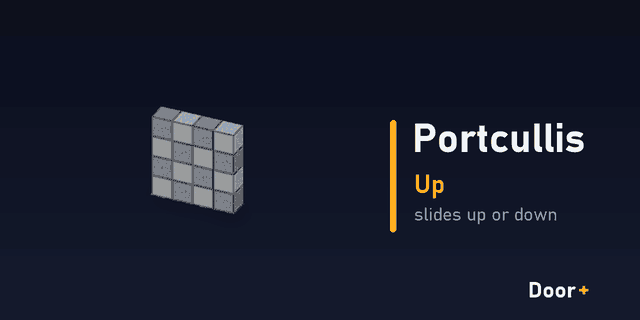

# Portcullis

The portcullis slides straight up into the ceiling or straight down into the ground. This page explains how to build
one, how far it moves and how to plug the hole it leaves. Creation id: `portcullis`.

## What it does

| State | Position |
|---|---|
| Closed (0) | The blocks where you built them |
| Open (1) | The blocks moved up (or down) by the number of **blocks to move** |

The blocks only move; they are not turned.

## How to build it

- **Shape**: any box. Usually a grid of iron bars or fences 1 block thick.
- **Front**: none.
- **Free space**: the cells the portcullis ends up in must be free. By default it moves by its own height, so you need
  as many free rows above it (or below it) as it is tall. See [Free space](../movement.md#free-space).

**Worked example**: a gate 5 blocks wide and 4 blocks tall, direction **Up**.

- By default it moves up 4 blocks: open, it fills the 5 × 4 area directly above the doorway, so those 4 rows above the
  gate must be empty (air, or a pocket inside the wall).
- With `blocks-to-move` set to 3, it moves up 3 blocks and its bottom row stays visible in the top of the doorway.

## Creating it

1. Type `/dp create portcullis [name]`. You receive the creation stick.
2. If you did not give a name, type it in chat.
3. Click the first corner of the door with the stick.
4. Click the opposite corner.
5. **Direction**: click **Up** or **Down**.
6. Add triggers if you want, then click **[Create]** on the summary.

There is no pivot step. The general procedure is on [Creating a door](../creating.md).

## Opening direction

| Direction | Default order |
|---|---|
| Up, Down | Up, then Down |

**Default**: Up if the cells above are free, otherwise Down if the cells below are free, otherwise Up. Change it later
with `/dp set <door> direction up|down` or the **Direction** button of the door menu, while the door is closed and
not moving.

## Type options

The portcullis has no type settings, but it uses the general **blocks to move** setting:

| | |
|---|---|
| Command | `/dp set <door> blocks-to-move <number>` |
| Menu | **Blocks to move** in the door menu (left +1, right −1, shift ×10) |
| Values | `0` to `limits.max-blocks-to-move` (default 64) |
| Default | `0`, shown as **type default**: the portcullis moves by its own height |
| When | Only while the door is closed and not moving |

## On the move

- **Speed**: `distance / (speed.blocks-per-second × speed multiplier)` seconds. The 4-block gate above takes 2 seconds
  with the default 2 blocks per second.
- **Checks**: the cells where the portcullis ends up and every cell it passes through on the way must be free.
- **Entities**: see [Collisions](../movement.md#collisions).

## Sounds

Config section `sounds.portcullis`:

| Sound | Default |
|---|---|
| `start` | `minecraft:block.piston.extend`, volume 1.0, pitch 0.6 |
| `loop` | `minecraft:block.chain.place`, volume 0.6, pitch 0.8, every 8 ticks |
| `end` | `minecraft:block.anvil.land`, volume 0.5, pitch 0.6 |

See [Sounds](../movement.md#sounds) for the format.

## Tips and common mistakes

!!! tip "Portcullis that sinks into the ground"
    Dig the slot it sinks into and fill it with **barrier** blocks. Barriers count as free space, so the portcullis
    can move into the slot; while it is up, the barriers stay in the slot and nobody falls in. When it goes down it
    takes their place, and when it comes back up the barriers return. See
    [Passable blocks](../movement.md#passable-blocks).

!!! warning "Blocks to move larger than the height"
    If `blocks-to-move` is larger than the height of the gate, the cells between the gate and its open position must
    be free too (or passable, such as barrier).

!!! warning "Cannot open: something is in the way"
    A block in the open position, often a torch or the lintel of the wall above the gate. The message gives its
    coordinates.
