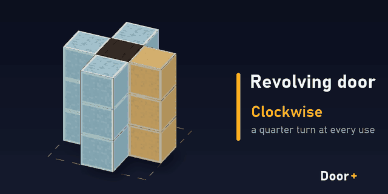

# Revolving door

The revolving door turns around a vertical axis through its centre every time it is used. It has no open position:
each use turns it by 90° (or 180°, 270°) and it always counts as closed. This page explains how to build it and how
its turns work. Creation id: `revolving_door`.

## What it does

| Action | Result |
|---|---|
| Toggle, Open | Turns by `quarter-turns` × 90° in the door's direction |
| Close | Turns by the same amount the other way |
| Follow state | Turns in the door's direction when the source becomes active; nothing when it becomes inactive |

The state is always **Closed** (0), and the area the door occupies never changes. Blocks with a direction turn with
the door.

## How to build it

- **Shape**: a box whose footprint is square: width (east–west) = depth (north–south). Any height.
- **Front**: none.
- **Axis**: vertical, through the centre of the footprint. With an odd size (3, 5, 7...) it passes through the centre
  column; with an even size it passes between four columns.
- **What turns**: every block inside the box turns. Empty cells stay empty, so the centre column can be air.
- **Free space**: the door ends where it started, so only the swept cells matter. Blocks in the corners of the square
  sweep a circle that reaches outside the square; those outside cells must be free (if `movement.check-swept-volume`
  is `true`).

**Worked example**: a revolving entrance with a 5 × 5 footprint, 3 blocks tall.

- Build the centre column (for example glass), and four arms of glass panes, 2 blocks long, from the centre to the
  middle of each side: a plus sign seen from above.
- Leave the rest of the 5 × 5 square empty: the arm tips stay inside the square while turning, so nothing outside is
  swept.
- Direction **Clockwise**, `quarter-turns` 1: each use turns the plus by 90° clockwise seen from above.

## Creating it

1. Type `/dp create revolving_door [name]`. You receive the creation stick.
2. If you did not give a name, type it in chat.
3. Click the first corner of the door with the stick.
4. Click the opposite corner.
5. **Direction**: click **Clockwise** or **Counter-clockwise** (seen from above).
6. Add triggers if you want, then click **[Create]** on the summary.

`quarter-turns` is not asked during creation; it starts at 1. The general procedure is on
[Creating a door](../creating.md).

## Opening direction

| Direction | Meaning (seen from above) |
|---|---|
| **Clockwise** (`cw`) | North → east → south → west |
| **Counter-clockwise** (`ccw`) | North → west → south → east |

**Default**: Clockwise (the revolving door never needs free space at the end, so the first direction is always
chosen). Change it later with `/dp set <door> direction cw|ccw` or the **Direction** button of the door menu.

## Type options

| | |
|---|---|
| Option | `quarter-turns` |
| Command | `/dp set <door> quarter-turns <1-3>` |
| Menu | **Type settings** → **Quarter turns** (left click next, right click previous) |
| Values | `1` (90°), `2` (180°), `3` (270°) |
| Default | `1` |
| When | Any time |

**Blocks to move** does not apply to this type.

## On the move

- **Speed**: each quarter turn takes the longer of `90 / (speed.degrees-per-second × multiplier)` and
  `(1.571 × radius) / (speed.max-tip-speed × multiplier)` seconds, where the radius is the distance from the axis to
  the corners of the selected box; `quarter-turns` 2 or 3 take two or three times as long. With the defaults, the 5 × 5
  example turns 90° in 2 seconds. The total is capped by `animation.max-ticks` (default 600 ticks = 30 seconds).
- **Checks**: only the swept cells outside the square.
- **Entities**: players inside the revolving door are not moved with it unless you use a collision mode; see
  [Collisions](../movement.md#collisions).
- **Auto-close**: has no effect on revolving doors.

## Sounds

Config section `sounds.revolving_door`:

| Sound | Default |
|---|---|
| `start` | `minecraft:block.wooden_door.open`, volume 0.8, pitch 1.0 |
| `loop` | none |
| `end` | `minecraft:block.wooden_door.close`, volume 0.8, pitch 1.0 |

See [Sounds](../movement.md#sounds) for the format.

## Tips and common mistakes

!!! warning "Footprint not square"
    **The footprint must be square (now W × D).** Select a region with the same size east–west and north–south.

!!! warning "Something is in the way, outside the door"
    Blocks in the corners of the square sweep outside it. Remove them, or keep the area around the door free.

!!! tip "Proximity trigger"
    A proximity trigger with the **Toggle** action turns the door when the first player enters the zone. See
    [Triggers](../../access/triggers.md).
