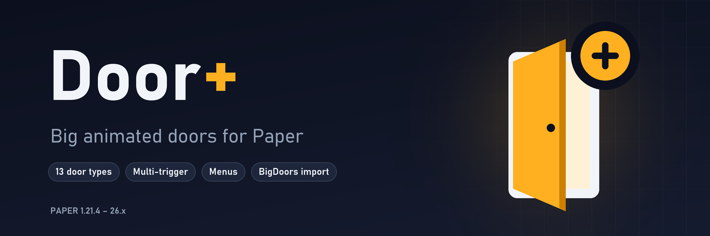

---
hide:
  - navigation
---

# Door+ Wiki

{ .dp-banner }

Door+ turns any group of blocks into a moving door: drawbridges, portcullises, garage doors, elevators,
windmills and 13 door types in total. Players open them with buttons, levers, pressure plates, redstone,
custom furniture, NPCs or just by walking up to them, and owners decide who may use each door from a menu.

This wiki explains how to install Door+, build every door type, control access and configure the plugin.

## Start here

-   **Install Door+**

    ---

    Requirements, first start and the permissions to give your players.

    [Installation](getting-started/installation.md)

-   **Build your first door**

    ---

    A five-minute tutorial: a big door that opens with a lever and closes by itself.

    [Your first door](getting-started/first-door.md)

-   **Coming from BigDoors?**

    ---

    Import your existing doors, owners and power blocks with one command.

    [Coming from BigDoors](getting-started/bigdoors-import.md)

-   **Pick a door type**

    ---

    What each of the 13 types does and how to build it.

    [Door types](doors/types/index.md)

## Find your way

| I want to… | Read |
|---|---|
| Choose who can open or edit a door | [Privacy and roles](access/privacy-and-roles.md) |
| Open a door with a button, plate, redstone, NPC or furniture | [Triggers](access/triggers.md) |
| Require a key or keycard | [Keys](access/keys.md) |
| Move several doors together | [Door groups](access/groups.md) |
| Change speed, direction, collisions or auto-close | [Editing and deleting](doors/editing.md) |
| Understand why a door does not move | [Movement and animation](doors/movement.md) |
| Look up a command or permission | [Commands](reference/commands.md) · [Permissions](reference/permissions.md) |
| Change limits or the config | [Limits](reference/limits.md) · [Configuration](reference/configuration.md) |
| Use MySQL or MariaDB | [Storage](reference/storage.md) |
| Show door information on scoreboards | [Placeholders](reference/placeholders.md) |
| Write a plugin that uses Door+ | [Developer API](developers/api.md) |
| Fix a problem | [Troubleshooting](help/troubleshooting.md) · [FAQ](help/faq.md) |

## Requirements at a glance

| | |
|---|---|
| Server | Paper 1.21.4 to 26.x, one jar for every version |
| Java | What your Paper version needs: 21 for 1.21.x, 25 for 26.x |
| Clients | Java Edition |
| Required plugins | None |
| Optional integrations | LuckPerms, WorldGuard, PlaceholderAPI, ItemsAdder, Nexo, Oraxen, CraftEngine, Citizens, FancyNpcs |

## Support

- Discord: <https://discord.gg/bHVeABaWF>
- Before asking, run `/dp admin version` and include its output: it shows the Door+ version, the animation
  engine and the active integrations.
